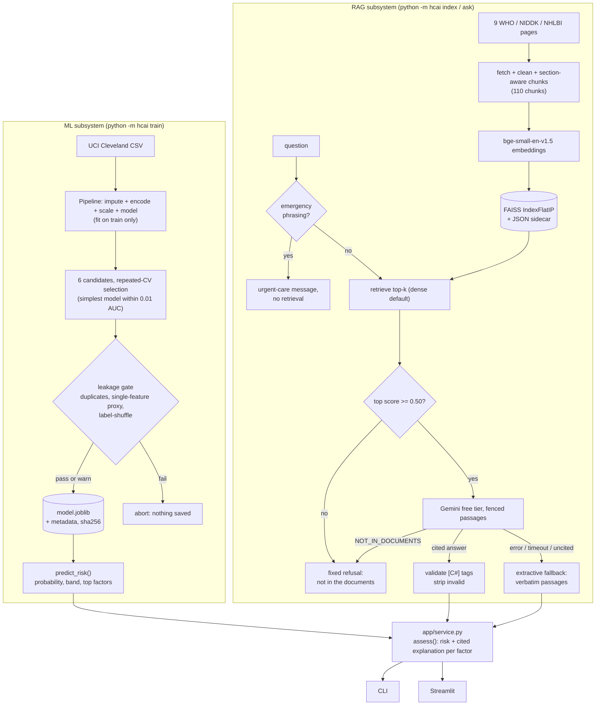

# hcai: healthcare ML risk classifier + grounded RAG question answering

**Demonstration prototype, not a medical device.** It does not diagnose or advise treatment. Built for the *AI/ML Engineer 40-hour assessment* (ML + RAG).

| Assessment part | What is here | Entry point |
|---|---|---|
| 1. Machine learning | Heart-disease presence classifier on UCI Cleveland: 6 candidate models, leakage-free pipeline, accuracy / precision / recall / F1 / ROC-AUC with bootstrap CIs, saved model + prediction function | `python -m hcai train` |
| 2. RAG | Question answering over 9 public WHO / NIDDK / NHLBI documents (FAISS), cited sources, explicit "not in the documents" refusal | `python -m hcai ask "..."` |
| 3. Interface (optional) | CLI and Streamlit app: enter patient fields → risk estimate + cited explanation of the top risk factors | `python -m hcai assess`, `streamlit run ...` |
| Extra | Second dataset (Kaggle Heart Failure, 918 rows) for a cross-dataset comparison; run archive and comparison; split-stability study | `train --dataset`, `compare`, `stability` |

Docs: [ARCHITECTURE](docs/ARCHITECTURE.md) · [DESIGN](docs/DESIGN.md) (decision log) · [MODEL_CARD](docs/MODEL_CARD.md) · [LIMITATIONS](docs/LIMITATIONS.md) · [RUN_COMPARISON](docs/RUN_COMPARISON.md) · [BUILD_NOTES](docs/BUILD_NOTES.md) · full generated reports in [docs/results/](docs/results/).

## Streamlit deployed app link
```
- URL: https://healthcaremlrag-m8hv7oaamxr6hehkaawwvq.streamlit.app/
```

## Project structure
```
.
├── README.md                  setup, results, analysis, disclosures
├── CLAUDE.md / AGENTS.md      project rules used during development (settled decisions, hard rules)
├── pyproject.toml             package metadata, dependencies, ruff / mypy / pytest settings
├── requirements.lock          exact versions the tests passed with
├── Makefile                   shortcuts (Windows: run `python -m hcai ...` directly)
├── .streamlit/config.toml     UI theme (light, blue palette)
├── configs/default.yaml       every tunable: seed, split, CV, grids, leakage limits, chunking, retrieval, thresholds, LLM
├── .env.example               GEMINI_API_KEY placeholder (the real .env is gitignored)
├── src/hcai/
│   ├── config.py logging.py errors.py textio.py report.py
│   ├── ml/                    data.py datasets.py schema.py features.py train.py evaluate.py
│   │                          leakage.py runs.py predict.py registry.py
│   ├── rag/                   fetch.py ingest.py chunking.py embeddings.py store.py bm25.py retriever.py
│   │                          rerank.py safety.py prompts.py generator.py pipeline.py
│   ├── monitoring/            metrics.py (JSONL, whitelisted fields)  drift.py (KS / chi-square)
│   ├── app/                   service.py cli.py streamlit_app.py
│   └── eval/                  rag_eval.py  golden.jsonl (30 questions)
├── scripts/fetch_docs.py      one-time document snapshot (+ manual --add-local fallback)
├── data/raw/docs/             document snapshots + manifest.json (url, licence, date, sha256)
├── tests/                     unit/ integration/ fixtures/ (hermetic: fake embedder, scripted LLM, synthetic data)
├── docs/                      ARCHITECTURE DESIGN MODEL_CARD LIMITATIONS BUILD_NOTES RUN_COMPARISON screenshots/ results/
└── artifacts/                 (gitignored) model.joblib, index/, reports/, runs/, datasets/<name>/
```

## Architecture
Two independent subsystems joined by a thin service layer. Contracts, trust boundaries and failure modes: [docs/ARCHITECTURE.md](docs/ARCHITECTURE.md).




## Results (generated from `artifacts/`)
<!-- RESULTS:START (generated by `python -m hcai report`; do not edit by hand) -->

#### Primary model (UCI Cleveland)
303 rows · train 242 / test 61 · absent features: none · selected model: **logreg**

| model | accuracy | precision | recall | F1 | ROC-AUC [95% CI] | CV ROC-AUC (train) |
|---|---|---|---|---|---|---|
| logreg **(selected)** | 0.885 | 0.839 | 0.929 | 0.881 | 0.961 [0.90, 1.00] | 0.899 ± 0.040 |
| logreg_fe | 0.885 | 0.839 | 0.929 | 0.881 | 0.969 [0.92, 1.00] | 0.898 ± 0.037 |
| svm_rbf | 0.869 | 0.812 | 0.929 | 0.867 | 0.960 [0.90, 1.00] | 0.897 ± 0.042 |
| random_forest | 0.869 | 0.812 | 0.929 | 0.867 | 0.949 [0.89, 0.99] | 0.894 ± 0.039 |
| hist_gb | 0.918 | 0.871 | 0.964 | 0.915 | 0.965 [0.92, 0.99] | 0.871 ± 0.041 |
| voting | 0.869 | 0.812 | 0.929 | 0.867 | 0.964 [0.91, 1.00] | 0.901 ± 0.037 |

Nested-CV ROC-AUC of the tuned winner (train split): 0.896 ± 0.044

Leakage checks: **WARN** · duplicate test rows 0 · strongest single feature `thal` AUC 0.78 · label-shuffle AUC 0.51 (chance = 0.5)
- test ROC-AUC 0.969 is above the usual ceiling 0.96, but every direct leakage check is clean (selected-model 95% CI [0.90, 1.00]). With a small test set this is within split noise; run `python -m hcai stability` to measure how often that happens.

#### Second dataset (Kaggle Heart Failure Prediction)
918 rows · train 734 / test 184 · absent features: ca, thal · selected model: **logreg**

| model | accuracy | precision | recall | F1 | ROC-AUC [95% CI] | CV ROC-AUC (train) |
|---|---|---|---|---|---|---|
| logreg **(selected)** | 0.902 | 0.896 | 0.931 | 0.913 | 0.936 [0.90, 0.97] | 0.927 ± 0.028 |
| logreg_fe | 0.897 | 0.895 | 0.922 | 0.908 | 0.935 [0.90, 0.97] | 0.927 ± 0.027 |
| svm_rbf | 0.897 | 0.888 | 0.931 | 0.909 | 0.944 [0.90, 0.98] | 0.924 ± 0.024 |
| random_forest | 0.886 | 0.872 | 0.931 | 0.900 | 0.932 [0.89, 0.97] | 0.931 ± 0.025 |
| hist_gb | 0.902 | 0.896 | 0.931 | 0.913 | 0.934 [0.89, 0.97] | 0.931 ± 0.026 |
| voting | 0.891 | 0.880 | 0.931 | 0.905 | 0.940 [0.90, 0.97] | 0.931 ± 0.024 |

Nested-CV ROC-AUC of the tuned winner (train split): 0.924 ± 0.017

Leakage checks: **PASS** · duplicate test rows 0 · strongest single feature `slope` AUC 0.82 · label-shuffle AUC 0.53 (chance = 0.5)

#### Split stability
100 random stratified splits, test n≈61, default hyper-parameters:

| model | mean AUC | std | 5th pct | 95th pct | max | splits > ceiling |
|---|---|---|---|---|---|---|
| logreg | 0.908 | 0.031 | 0.862 | 0.958 | 0.984 | 5% |
| random_forest | 0.897 | 0.033 | 0.843 | 0.945 | 0.969 | 1% |
| hist_gb | 0.869 | 0.035 | 0.807 | 0.927 | 0.948 | 0% |

#### Archived training runs

| run | build | dataset | model | test ROC-AUC [95% CI] | leakage verdict |
|---|---|---|---|---|---|
| 20261124-072319_cleveland_build03 | 0.3.0 | cleveland | logreg | 0.961 [0.90, 1.00] | warn |
| 20261124-073615_kaggle_heart_failure_kaggle | 0.3.0 | kaggle_heart_failure | logreg | 0.936 [0.90, 0.97] | pass |

Comparisons (full tables in `docs/results/`):
- **20261124-072319_cleveland_build03** vs **20261124-073615_kaggle_heart_failure_kaggle**: Different datasets: populations, feature sets and test sets differ, so absolute numbers are not directly comparable. Compare the pattern (model ranking, CI width, calibration), not the decimals. 95% CIs overlap.

#### RAG evaluation (golden set)
30 items · threshold in use 0.500 (false refusal 0.00, false answer 0.62)

| metric | value |
|---|---|
| retrieval hit@1 / hit@3 / hit@5 | 1.00 / 1.00 / 1.00 |
| retrieval MRR | 1.00 |
| refusal precision / recall | 0.88 / 0.88 |
| false-refusal / false-answer rate | 0.05 / 0.12 |
| emergency recall · false alarms | 1.00 · 0 |
| answers (LLM / extractive) | 21 / 0 |
| faithfulness proxy (lexical, LLM answers) | 1.00 |
| latency p50 / p95 (ms) | 3764 / 7406 |
| behaviour failures | 2 |

| retrieval variant | hit@1 | hit@3 | MRR |
|---|---|---|---|
| dense | 1.00 | 1.00 | 1.00 |
| bm25 | 0.71 | 0.95 | 0.82 |
| hybrid (RRF) | 0.95 | 1.00 | 0.98 |
| hybrid + diversity cap | 0.95 | 1.00 | 0.98 |

<!-- RESULTS:END -->

## Key findings
Figures from the 24 Nov 2026 run (seed 42). Details: [model report](docs/results/model_report.md), [MODEL_CARD](docs/MODEL_CARD.md), [RAG evaluation](docs/results/rag_eval.md), [RUN_COMPARISON](docs/RUN_COMPARISON.md).

**ML (UCI Cleveland, 303 rows, 242 / 61 split)**
- Six candidates tuned in repeated stratified CV on the training split. Logistic regression was selected: the best CV model (voting, 0.901) beat it (0.899) by less than the 0.01 margin, so the simplest model won. Test: ROC-AUC 0.961 [0.90, 1.00], accuracy 0.885, precision 0.839, recall 0.929, F1 0.881. All candidates' CIs overlap.
- **Trust 0.90, not 0.96.** Nested CV is 0.896 ± 0.044 and a 100-split study gives mean 0.908 (std 0.031); this test split was a favourable one. The leakage gate reports WARN, not a failure: 0 train/test duplicates, strongest single feature 0.78 AUC, shuffled-label AUC 0.51.
- Kaggle Heart Failure (918 rows, no `ca`/`thal`), comparison only: logistic regression again, test ROC-AUC 0.936 [0.90, 0.97], nested CV 0.924. Not comparable in absolute terms (different patients and features, partly Cleveland-derived).

**RAG (9 documents, 110 chunks, 30 golden questions, 21 with expected sources)**
- Retrieval (dense, default): hit@1 1.00, MRR 1.00. Hybrid (0.95 / 0.98) did not beat dense, so dense is the default (DESIGN §12f).
- Refusal precision 0.88, recall 0.88; emergency recall 1.00, 0 false alarms; 21 / 21 LLM answers with 0 invalid citations; latency p50 3.8 s, p95 7.4 s.
- **Two failures kept visible:** U04 ("hypertension in pregnancy") is answered although the corpus has no pregnancy guidance; X03 (typos) is refused because the LLM returns `NOT_IN_DOCUMENTS` even though retrieval ranks the right document first. Fixes and reasoning: [LIMITATIONS](docs/LIMITATIONS.md).

## Quickstart on Windows (VS Code + PowerShell)
Prerequisites: Python 3.12 or 3.13 (python.org, tick "Add to PATH"), VS Code with the *Python* and *Ruff* extensions, internet for the first run.

```powershell
git clone <this repo> ; cd <repo folder>
py -3.12 -m venv .venv
.\.venv\Scripts\Activate.ps1          # if blocked: Set-ExecutionPolicy -Scope Process Bypass
pip install -r requirements.lock
pip install -e . --no-deps
python -m hcai status                 # first line must name THIS folder and version 0.3.0
```

**1. Verify (offline, no key needed)**
```powershell
python -m pytest                      # hermetic tests; takes 1-10 minutes depending on the machine
python -m ruff check . ; python -m mypy
```
**2. ML**
```powershell
python -m hcai data                   # downloads UCI Cleveland once, caches in data/raw
python -m hcai train --tag build03    # ~2 min; metrics, CIs, plots, leakage checks -> artifacts/reports/
python -m hcai stability              # how much test AUC moves between random splits (~1 min)
```
**3. RAG**
```powershell
copy .env.example .env                # put GEMINI_API_KEY=... (free key: aistudio.google.com/apikey); without it answers are extractive
python scripts\fetch_docs.py          # snapshots 9 documents + manifest.json (alternates used if a page blocks us)
python -m hcai index                  # downloads bge-small (~130 MB) the first time
python -m hcai eval                   # golden-set evaluation with ablation (takes a few minutes with the LLM)
```
If a document cannot be downloaded: save its text by hand (`## ` for headings) and run `python scripts\fetch_docs.py --add-local page.txt --doc-id ID --title T --url U --license L`.

**4. Use it**
```powershell
python -m hcai ask "What are the risk factors for high blood pressure?"
python -m hcai assess --example --out patient.json      # writes UTF-8; do not use > in PowerShell 5
python -m hcai assess --input patient.json
python -m streamlit run src/hcai/app/streamlit_app.py
python -m hcai monitor                                   # request metrics; --drift-csv rows.csv for drift
```
**5. Second dataset and comparisons** (details: [RUN_COMPARISON](docs/RUN_COMPARISON.md))
```powershell
# download heart.csv from https://www.kaggle.com/datasets/fedesoriano/heart-failure-prediction (free account), unzip it
python -m hcai train --dataset kaggle_heart_failure --source-file "$HOME\Downloads\heart_kaggle\heart.csv" --tag kaggle
python -m hcai runs                                      # list archived runs
python -m hcai compare build03 kaggle
```
Problems (old install shadowing, `train` stops, CDC 403, slow tests): see the issue table in [docs/BUILD_NOTES.md](docs/BUILD_NOTES.md); `python -m hcai status` shows which folder and version is running.

**6. Refresh the results block above** after any new run: `python -m hcai report` (also copies the full reports to `docs/results/`).


## Screenshots
Add after running the app on the real data (see `docs/screenshots/README.md`):
`docs/screenshots/streamlit_assess.png` (risk estimate + cited explanations), `docs/screenshots/streamlit_ask.png` (cited answer and a refusal), `docs/screenshots/cli_ask.png`.


```

## External services, libraries and models (disclosure)
- **Datasets**: UCI Heart Disease, Cleveland subset, via `ucimlrepo` (https://archive.ics.uci.edu/dataset/45/heart+disease), the primary dataset; Kaggle *Heart Failure Prediction Dataset* by fedesoriano (https://www.kaggle.com/datasets/fedesoriano/heart-failure-prediction), used only for the comparison and not redistributed in this repository (download it yourself; check its licence on the Kaggle page).
- **Documents** (one-time snapshots, licence and URL per file in `data/raw/docs/manifest.json`): WHO fact sheets (CC BY-NC-SA 3.0 IGO), NIDDK and NHLBI pages (US government works). Verify each licence on its page.
- **Embedding model**: `BAAI/bge-small-en-v1.5` via sentence-transformers (downloaded from Hugging Face on first use). Optional cross-encoder reranker `BAAI/bge-reranker-base` is off by default.
- **LLM / API**: Google Gemini API, free tier, default `gemini-3.5-flash-lite`, falling back to `gemini-3.1-flash-lite` then `gemini-3.6-flash` when rate-limited; temperature 0; needs `GEMINI_API_KEY`. Free-tier terms allow Google to use prompts to improve its products, so **never type real patient information**. The app sends only the question and retrieved passages, never the 13 patient fields. Optional paid provider: Anthropic (`llm.provider: anthropic`). Without a key, answers are extractive.
- **Libraries**: numpy, pandas, scikit-learn, scipy, joblib, pydantic, PyYAML, matplotlib, ucimlrepo, threadpoolctl, faiss-cpu, sentence-transformers (PyTorch), google-genai, streamlit, requests, beautifulsoup4. Optional: anthropic. Dev: pytest, pytest-cov, ruff, mypy, pandas-stubs, types-requests, types-PyYAML. Each dependency's reason is in `docs/DESIGN.md` §13.

## Testing
`python -m pytest` runs 227 hermetic tests (fake embedder, scripted LLM, synthetic data, no network). What they cover: [docs/ARCHITECTURE.md §10](docs/ARCHITECTURE.md). The golden-set `eval` uses the real embedder and LLM and is run on demand.

## Limitations and future work
- Small, old, single-site data; a 61-row test set means wide CIs and no external validation.
- Probabilities are not clinically calibrated; several inputs need clinical tests.
- RAG covers general-population English fact sheets only; the golden set is author-written; the emergency gate is keyword-based; U04 and X03 still fail.
- Next steps: population-aware refusal and query normalisation (re-evaluated), external validation, clinician-reviewed golden set, dense vs hybrid on a larger corpus.

Full table with consequences and mitigations: [docs/LIMITATIONS.md](docs/LIMITATIONS.md). `joblib` files are pickles: only load models you trained yourself.

## How this was built
Developed with AI assistance (Claude). Decision log: [DESIGN](docs/DESIGN.md); bugs found in real runs and their fixes: [BUILD_NOTES](docs/BUILD_NOTES.md). I can explain every module.
