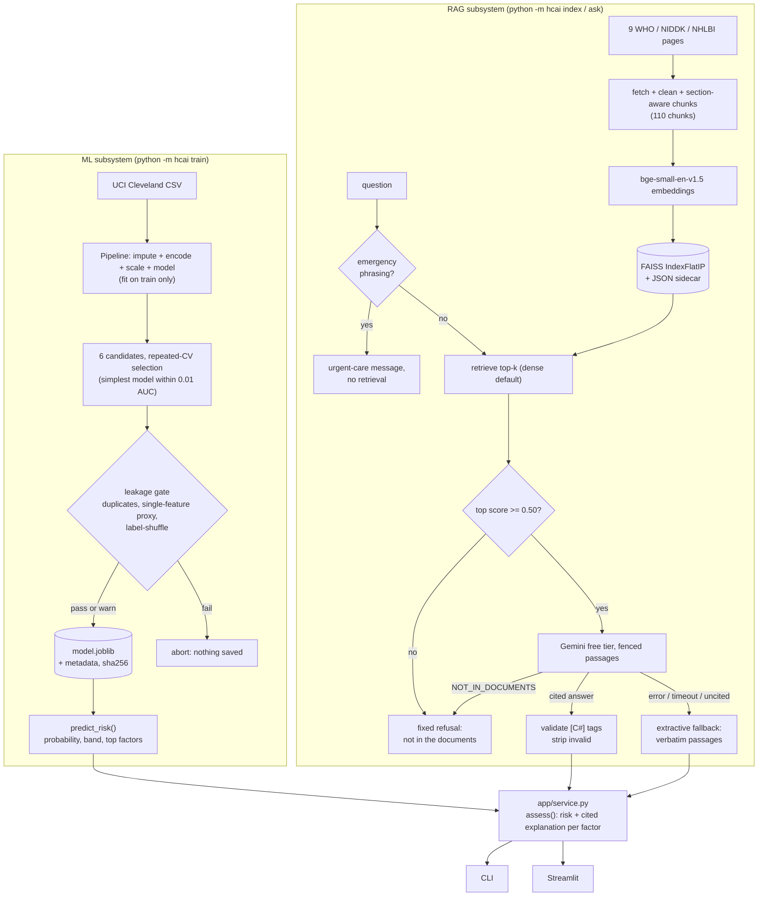

# hcai: healthcare ML risk classifier + grounded RAG question answering

**Demonstration prototype, not a medical device.** It does not diagnose or advise treatment. Built for the *AI/ML Engineer 40-hour assessment* (ML + RAG).

| Assessment part | What is here | Entry point |
|---|---|---|
| 1. Machine learning | Heart-disease presence classifier on UCI Cleveland: 6 candidate models, leakage-free pipeline, accuracy / precision / recall / F1 / ROC-AUC with bootstrap CIs, saved model + prediction function | `python -m hcai train` |
| 2. RAG | Question answering over 9 public WHO / NIDDK / NHLBI documents (FAISS), cited sources, explicit "not in the documents" refusal | `python -m hcai ask "..."` |
| 3. Interface (optional) | CLI and Streamlit app: enter patient fields → risk estimate + cited explanation of the top risk factors | `python -m hcai assess`, `streamlit run ...` |
| Extra | Second dataset (Kaggle Heart Failure, 918 rows) for a cross-dataset comparison; run archive and comparison; split-stability study | `train --dataset`, `compare`, `stability` |

Docs: [ARCHITECTURE](docs/ARCHITECTURE.md) · [DESIGN](docs/DESIGN.md) (decision log) · [MODEL_CARD](docs/MODEL_CARD.md) · [LIMITATIONS](docs/LIMITATIONS.md) · [RUN_COMPARISON](docs/RUN_COMPARISON.md) · [BUILD_NOTES](docs/BUILD_NOTES.md) · full generated reports in [docs/results/](docs/results/).

## Results (generated from `artifacts/`; nothing here is typed by hand)
<!-- RESULTS:START (generated by `python -m hcai report`; do not edit by hand) -->
_Generated 2026-11-24 08:35 UTC by hcai 0.3.0 from `artifacts/`. Test sets are small (Cleveland n≈61): read every number with its CI._

#### Primary model (UCI Cleveland)
303 rows · train 242 / test 61 · absent features: none · selected model: **logreg**

| model | accuracy | precision | recall | F1 | ROC-AUC [95% CI] | CV ROC-AUC (train) |
|---|---|---|---|---|---|---|
| logreg **(selected)** | 0.885 | 0.839 | 0.929 | 0.881 | 0.961 [0.90, 1.00] | 0.899 ± 0.040 |
| logreg_fe | 0.885 | 0.839 | 0.929 | 0.881 | 0.969 [0.92, 1.00] | 0.898 ± 0.037 |
| svm_rbf | 0.869 | 0.812 | 0.929 | 0.867 | 0.960 [0.90, 1.00] | 0.897 ± 0.042 |
| random_forest | 0.869 | 0.812 | 0.929 | 0.867 | 0.949 [0.89, 0.99] | 0.894 ± 0.039 |
| hist_gb | 0.918 | 0.871 | 0.964 | 0.915 | 0.965 [0.92, 0.99] | 0.871 ± 0.041 |
| voting | 0.869 | 0.812 | 0.929 | 0.867 | 0.964 [0.91, 1.00] | 0.901 ± 0.037 |

Nested-CV ROC-AUC of the tuned winner (train split): 0.896 ± 0.044

Leakage checks: **WARN** · duplicate test rows 0 · strongest single feature `thal` AUC 0.78 · label-shuffle AUC 0.51 (chance = 0.5)
- test ROC-AUC 0.969 is above the usual ceiling 0.96, but every direct leakage check is clean (selected-model 95% CI [0.90, 1.00]). With a small test set this is within split noise; run `python -m hcai stability` to measure how often that happens.

#### Second dataset (Kaggle Heart Failure Prediction)
918 rows · train 734 / test 184 · absent features: ca, thal · selected model: **logreg**

| model | accuracy | precision | recall | F1 | ROC-AUC [95% CI] | CV ROC-AUC (train) |
|---|---|---|---|---|---|---|
| logreg **(selected)** | 0.902 | 0.896 | 0.931 | 0.913 | 0.936 [0.90, 0.97] | 0.927 ± 0.028 |
| logreg_fe | 0.897 | 0.895 | 0.922 | 0.908 | 0.935 [0.90, 0.97] | 0.927 ± 0.027 |
| svm_rbf | 0.897 | 0.888 | 0.931 | 0.909 | 0.944 [0.90, 0.98] | 0.924 ± 0.024 |
| random_forest | 0.886 | 0.872 | 0.931 | 0.900 | 0.932 [0.89, 0.97] | 0.931 ± 0.025 |
| hist_gb | 0.902 | 0.896 | 0.931 | 0.913 | 0.934 [0.89, 0.97] | 0.931 ± 0.026 |
| voting | 0.891 | 0.880 | 0.931 | 0.905 | 0.940 [0.90, 0.97] | 0.931 ± 0.024 |

Nested-CV ROC-AUC of the tuned winner (train split): 0.924 ± 0.017

Leakage checks: **PASS** · duplicate test rows 0 · strongest single feature `slope` AUC 0.82 · label-shuffle AUC 0.53 (chance = 0.5)

#### Split stability
100 random stratified splits, test n≈61, default hyper-parameters:

| model | mean AUC | std | 5th pct | 95th pct | max | splits > ceiling |
|---|---|---|---|---|---|---|
| logreg | 0.908 | 0.031 | 0.862 | 0.958 | 0.984 | 5% |
| random_forest | 0.897 | 0.033 | 0.843 | 0.945 | 0.969 | 1% |
| hist_gb | 0.869 | 0.035 | 0.807 | 0.927 | 0.948 | 0% |

#### Archived training runs

| run | build | dataset | model | test ROC-AUC [95% CI] | leakage verdict |
|---|---|---|---|---|---|
| 20261124-072319_cleveland_build03 | 0.3.0 | cleveland | logreg | 0.961 [0.90, 1.00] | warn |
| 20261124-073615_kaggle_heart_failure_kaggle | 0.3.0 | kaggle_heart_failure | logreg | 0.936 [0.90, 0.97] | pass |

Comparisons (full tables in `docs/results/`):
- **20261124-072319_cleveland_build03** vs **20261124-073615_kaggle_heart_failure_kaggle**: Different datasets: populations, feature sets and test sets differ, so absolute numbers are not directly comparable. Compare the pattern (model ranking, CI width, calibration), not the decimals. 95% CIs overlap.

#### RAG evaluation (golden set)
30 items · threshold in use 0.500 (false refusal 0.00, false answer 0.62)

| metric | value |
|---|---|
| retrieval hit@1 / hit@3 / hit@5 | 1.00 / 1.00 / 1.00 |
| retrieval MRR | 1.00 |
| refusal precision / recall | 0.88 / 0.88 |
| false-refusal / false-answer rate | 0.05 / 0.12 |
| emergency recall · false alarms | 1.00 · 0 |
| answers (LLM / extractive) | 21 / 0 |
| faithfulness proxy (lexical, LLM answers) | 1.00 |
| latency p50 / p95 (ms) | 3764 / 7406 |
| behaviour failures | 2 |

| retrieval variant | hit@1 | hit@3 | MRR |
|---|---|---|---|
| dense | 1.00 | 1.00 | 1.00 |
| bm25 | 0.71 | 0.95 | 0.82 |
| hybrid (RRF) | 0.95 | 1.00 | 0.98 |
| hybrid + diversity cap | 0.95 | 1.00 | 0.98 |

<!-- RESULTS:END -->

## Analysis

*Figures below are from the run of 24 Nov 2026 (seed 42, `configs/default.yaml`); the generated block above has the full tables.*

### ML: which model is best, and how much to trust it
- **Data.** UCI Cleveland, 303 patients, target `num > 0` (45.9% positive), 242 train / 61 test, stratified. Missing values: `ca` (4) and `thal` (2), imputed inside the pipeline and flagged.
- **Six candidates** (logistic regression, logistic regression + 2 engineered features, RBF-SVM, random forest, gradient boosting, soft-vote ensemble) were tuned by grid search in 5×3 repeated stratified CV on the training split only. CV ROC-AUC: 0.871 – 0.901. Held-out test ROC-AUC: 0.949 – 0.969, and **all 95% bootstrap CIs overlap**, as does every paired difference against the baseline.
- **Selected: logistic regression.** The best CV score (voting, 0.901) beat it (0.899) by less than the 0.01 selection margin, so the simplest, best-calibrated model was kept. On the test set it reaches ROC-AUC 0.961 [0.90, 1.00], accuracy 0.885, precision 0.839, recall 0.929, F1 0.881.
- **Read the 0.961 with care.** It is higher than the honest estimates: nested-CV 0.896 ± 0.044 and a 100-split study of the same pipeline (mean 0.908, std 0.031, 5% of clean splits above 0.96). The test split was a favourable one, so the expected performance on new patients is about 0.90, not 0.96. The training run reported this as a **WARN, not a failure**, because all direct leakage checks were clean: 0 duplicate rows between train and test, the strongest single feature (`thal`) alone reaches only 0.78 AUC, and a baseline trained on shuffled labels scores 0.51 on the test set (chance level).
- **Why a warning rather than an abort.** An earlier build aborted on this exact split because its best candidate scored 0.965 (the same number the current gradient-boosting model gets on this split) and a fixed ceiling of 0.96 was exceeded. A 61-row test set cannot support a fixed ceiling, so the gate was replaced by the direct checks above (BUILD_NOTES #1). The models and metrics did not change between builds; only the gate did.
- **Second dataset (Kaggle Heart Failure Prediction, 918 rows, no `ca`/`thal`).** Same pipeline, selected model again logistic regression: test ROC-AUC 0.936 [0.90, 0.97], accuracy 0.902, precision 0.896, recall 0.931; CV 0.927 ± 0.028, nested-CV 0.924 ± 0.017; leakage checks PASS (shuffle AUC 0.53). All six models are within 0.932 – 0.944 on its test set. The test set is three times larger (184 rows), hence narrower CIs. Absolute numbers are **not comparable** with Cleveland's (different patients, different feature set, and the Kaggle file contains Cleveland-derived rows), but the pattern agrees: a linear model matches the tree ensembles on small clinical tables, and the CIs overlap.
- **Recall-oriented use.** The selected model reaches recall 0.929 at the default 0.5 threshold; a separate recall-targeted threshold chosen on out-of-fold training predictions is in `model_report.md`.

### RAG: what works, what fails
- **Corpus.** 9 documents, 110 chunks: 6 WHO fact sheets (hypertension, cardiovascular diseases, diabetes, healthy diet, physical activity, tobacco), 1 NIDDK page (diabetes symptoms and causes) and 2 NHLBI pages (high blood pressure; causes and risk factors). The two CDC pages returned HTTP 403, so documented NHLBI alternates were used; the manifest records the URL actually fetched.
- **Golden set.** 30 questions written by the author (answerable, out-of-scope, and adversarial: typos, prompt injection, emergency phrasing); 21 have an expected source document.
- **Retrieval (default `dense`).** hit@1 1.00, hit@3 1.00, MRR 1.00 (n = 21). **Ablation** (ranking only): BM25 0.71 / 0.95 (hit@1 / hit@3), hybrid RRF 0.95 / 1.00, hybrid + diversity cap 0.95 / 1.00. **Hybrid did not beat dense** on this small, clean corpus (a one-question difference, within noise), so by the DESIGN rule (adopt a variant only if it beats dense) the default is `rag.retrieval_mode: dense`. Per-query time was similar for all variants (about 74 to 91 ms in the final run; an earlier run measured hybrid as slower, so I do not claim a speed difference). `hybrid` is a one-line change in `configs/default.yaml`; n = 21 supports "no evidence hybrid helps here", not "hybrid never helps".
- **Refusal behaviour.** Precision 0.88, recall 0.88, false-refusal rate 0.05 (1 of 21 answerable questions refused), false-answer rate 0.12 (1 of 8 out-of-scope questions answered). At the configured retrieval threshold (0.50) the score gate alone lets 62% of out-of-scope questions through; the LLM's own `NOT_IN_DOCUMENTS` reply does the rest, so both layers are needed. The suggested stricter threshold (0.67) would **not** fix the failure below (its top score is 0.704) and 0.72 would start refusing answerable questions (10%), so the threshold stays at 0.50.
- **Safety.** Emergency recall 1.00, 0 false alarms on non-emergency items. The gate is a keyword/phrasing rule set tested on a short list, not on real traffic.
- **Generation.** 21 of 21 answers came from the LLM (Gemini free tier), 0 invalid citations, 0 fallbacks; lexical faithfulness proxy 1.00 (a proxy for overlap with the sources, not entailment); latency p50 3.8 s, p95 7.4 s.
- **Two failures, left visible rather than tuned away:**
  1. *U04, "How should hypertension in pregnancy be treated?"*: answered instead of refused (top score 0.704). The corpus is general-population fact sheets with no pregnancy guidance, so the answer is not supported for that population. Fix to try: a prompt rule to refuse when the passages do not address the population or condition asked, then re-run the golden set.
  2. *X03, "wat r the sympotms of diabtes"* (typos): refused. Retrieval is **not** the cause in the dense run (the expected diabetes document is ranked first, top score 0.558, above the 0.50 threshold); the LLM returned `NOT_IN_DOCUMENTS` for the misspelt question. Fix to try: query spelling normalisation or a rewrite step before generation, then re-run.

## Quickstart on Windows (VS Code + PowerShell)
Prerequisites: Python 3.12 or 3.13 (python.org, tick "Add to PATH"), VS Code with the *Python* and *Ruff* extensions, internet for the first run.

```powershell
git clone <this repo> ; cd <repo folder>
py -3.12 -m venv .venv
.\.venv\Scripts\Activate.ps1          # if blocked: Set-ExecutionPolicy -Scope Process Bypass
pip install -r requirements.lock
pip install -e . --no-deps
python -m hcai status                 # first line must name THIS folder and version 0.3.0
```
In VS Code: Ctrl+Shift+P → *Python: Select Interpreter* → `.venv`. *Run and Debug* has ready configurations (`.vscode/launch.json`).

**1. Verify (offline, no key needed)**
```powershell
python -m pytest                      # hermetic tests; takes 1-10 minutes depending on the machine
python -m ruff check . ; python -m mypy
```
**2. ML**
```powershell
python -m hcai data                   # downloads UCI Cleveland once, caches in data/raw
python -m hcai train --tag build03    # ~2 min; metrics, CIs, plots, leakage checks -> artifacts/reports/
python -m hcai stability              # how much test AUC moves between random splits (~1 min)
```
**3. RAG**
```powershell
copy .env.example .env                # put GEMINI_API_KEY=... (free key: aistudio.google.com/apikey); without it answers are extractive
python scripts\fetch_docs.py          # snapshots 9 documents + manifest.json (alternates used if a page blocks us)
python -m hcai index                  # downloads bge-small (~130 MB) the first time
python -m hcai eval                   # golden-set evaluation with ablation (takes a few minutes with the LLM)
```
If a document cannot be downloaded: save its text by hand (`## ` for headings) and run `python scripts\fetch_docs.py --add-local page.txt --doc-id ID --title T --url U --license L`.

**4. Use it**
```powershell
python -m hcai ask "What are the risk factors for high blood pressure?"
python -m hcai assess --example --out patient.json      # writes UTF-8; do not use > in PowerShell 5
python -m hcai assess --input patient.json
python -m streamlit run src/hcai/app/streamlit_app.py
python -m hcai monitor                                   # request metrics; --drift-csv rows.csv for drift
```
**5. Second dataset and comparisons** (details: [RUN_COMPARISON](docs/RUN_COMPARISON.md))
```powershell
# download heart.csv from https://www.kaggle.com/datasets/fedesoriano/heart-failure-prediction (free account), unzip it
python -m hcai train --dataset kaggle_heart_failure --source-file "$HOME\Downloads\heart_kaggle\heart.csv" --tag kaggle
python -m hcai runs                                      # list archived runs
python -m hcai compare build03 kaggle
```
**6. Refresh the results block above** after any new run: `python -m hcai report` (also copies the full reports to `docs/results/`).

`make <target>` works where `make` exists (see Makefile).

### Troubleshooting
| Symptom | Fix |
|---|---|
| `status` shows a different folder or an old version | An older install shadows it. In this folder: `pip install -e . --no-deps` |
| `train` stops with "Model NOT saved: ..." | A direct leakage check failed. Read `artifacts\reports\model_report.md`; a test AUC above 0.96 alone only prints a NOTE |
| A CDC page returns 403 | Handled: the NHLBI alternate is used and recorded in the manifest |
| `ask` is slow or shows `llm_fallback` | Free-tier quota or network; the extractive fallback still answers. Wait a minute or use `--no-llm` |
| `UnicodeDecodeError` reading patient.json | Fixed; prefer `--example --out patient.json` |
| Tests are slow | `python -m pytest --durations=10` |

## Screenshots
Add after running the app on the real data (see `docs/screenshots/README.md`):
`docs/screenshots/streamlit_assess.png` (risk estimate + cited explanations), `docs/screenshots/streamlit_ask.png` (cited answer and a refusal), `docs/screenshots/cli_ask.png`.

## Project structure
```
.
├── README.md                  setup, results, analysis, disclosures
├── CLAUDE.md / AGENTS.md      project rules used during development (settled decisions, hard rules)
├── pyproject.toml             package metadata, dependencies, ruff / mypy / pytest settings
├── requirements.lock          exact versions the tests passed with
├── Makefile                   shortcuts (Windows: run `python -m hcai ...` directly)
├── .streamlit/config.toml     UI theme (light, blue palette)
├── configs/default.yaml       every tunable: seed, split, CV, grids, leakage limits, chunking, retrieval, thresholds, LLM
├── .env.example               GEMINI_API_KEY placeholder (the real .env is gitignored)
├── src/hcai/
│   ├── config.py logging.py errors.py textio.py report.py
│   ├── ml/                    data.py datasets.py schema.py features.py train.py evaluate.py
│   │                          leakage.py runs.py predict.py registry.py
│   ├── rag/                   fetch.py ingest.py chunking.py embeddings.py store.py bm25.py retriever.py
│   │                          rerank.py safety.py prompts.py generator.py pipeline.py
│   ├── monitoring/            metrics.py (JSONL, whitelisted fields)  drift.py (KS / chi-square)
│   ├── app/                   service.py cli.py streamlit_app.py
│   └── eval/                  rag_eval.py  golden.jsonl (30 questions)
├── scripts/fetch_docs.py      one-time document snapshot (+ manual --add-local fallback)
├── data/raw/docs/             document snapshots + manifest.json (url, licence, date, sha256)
├── tests/                     unit/ integration/ fixtures/ (hermetic: fake embedder, scripted LLM, synthetic data)
├── docs/                      ARCHITECTURE DESIGN MODEL_CARD LIMITATIONS BUILD_NOTES RUN_COMPARISON screenshots/ results/
└── artifacts/                 (gitignored) model.joblib, index/, reports/, runs/, datasets/<name>/
```

## Architecture
Two independent subsystems joined by a thin service layer; either can be down without the other. Full description, contracts and failure modes: [docs/ARCHITECTURE.md](docs/ARCHITECTURE.md).



Grounding rules: answers must carry `[C#]` tags (grouped tags like `[C1, C2]` are accepted); tags outside the retrieved set are stripped and logged; uncited LLM text is never shown; a score below the threshold or a `NOT_IN_DOCUMENTS` reply gives the fixed refusal. Retrieved text is fenced and treated as data. Only the question and retrieved passages go to the LLM, never the 13 patient fields.

## External services, libraries and models (disclosure)
- **Datasets**: UCI Heart Disease, Cleveland subset, via `ucimlrepo` (https://archive.ics.uci.edu/dataset/45/heart+disease), the primary dataset; Kaggle *Heart Failure Prediction Dataset* by fedesoriano (https://www.kaggle.com/datasets/fedesoriano/heart-failure-prediction), used only for the comparison and not redistributed in this repository (download it yourself; check its licence on the Kaggle page).
- **Documents** (one-time snapshots, licence and URL per file in `data/raw/docs/manifest.json`): WHO fact sheets (CC BY-NC-SA 3.0 IGO), NIDDK and NHLBI pages (US government works). Verify each licence on its page.
- **Embedding model**: `BAAI/bge-small-en-v1.5` via sentence-transformers (downloaded from Hugging Face on first use). Optional cross-encoder reranker `BAAI/bge-reranker-base` is off by default.
- **LLM / API**: Google Gemini API, free tier, default `gemini-3.5-flash-lite`, falling back to `gemini-3.1-flash-lite` then `gemini-3.6-flash` when rate-limited; temperature 0; needs `GEMINI_API_KEY`. Free-tier terms allow Google to use prompts to improve its products, so **never type real patient information**. The app sends only the question and retrieved passages, never the 13 patient fields. Optional paid provider: Anthropic (`llm.provider: anthropic`). Without a key, answers are extractive.
- **Libraries**: numpy, pandas, scikit-learn, scipy, joblib, pydantic, PyYAML, matplotlib, ucimlrepo, threadpoolctl, faiss-cpu, sentence-transformers (PyTorch), google-genai, streamlit, requests, beautifulsoup4. Optional: anthropic. Dev: pytest, pytest-cov, ruff, mypy, pandas-stubs, types-requests, types-PyYAML. Each dependency's reason is in `docs/DESIGN.md` §13.

## Testing
`python -m pytest` runs hermetic tests: fake and hashing embedders, a scripted LLM and Gemini SDK, synthetic patient data (tests only; never used for reported metrics), no network. They cover input validation, the leakage gate (clean, warn, abort), artifact version/checksum checks, chunking invariants, ingest errors, index corruption, citation parsing and stripping, prompt injection (question and poisoned document), the emergency gate, degradation paths (model missing, index missing, LLM down), log privacy, run comparison, README report generation, CLI messages and a Streamlit smoke test. The golden-set `eval` (real embedder, real LLM) is run on demand, not in CI.

## Known limitations and future improvements
Full list: [docs/LIMITATIONS.md](docs/LIMITATIONS.md).

| Area | Limitation | Consequence | Mitigation now / next step |
|---|---|---|---|
| Data | 303 patients, one 1980s hospital; 61-row test set | CIs about ±0.05 AUC; one split can mislead (test 0.961 vs nested-CV 0.896) | Report CIs, nested CV and a 100-split study; next: validate on the other UCI sites |
| Data | Kaggle comparison file is partly Cleveland-derived, different features | Not an external validation, numbers not comparable | Labelled as a comparison only |
| Model | Probabilities not clinically calibrated; bands are demo cut-points | Risk % must not be read as a clinical probability | Sigmoid calibration only if Brier improves; next: calibrate on more data |
| Model | Needs `ca`, `thal`, `oldpeak`, `restecg`, `thalach` (clinical tests) | A lay user cannot fill all fields | UI marks them; missing values are imputed and flagged |
| Model | Sex imbalance (about 68% male) | Less certain for women | Disclosed in MODEL_CARD |
| Model | Factor explanations are one-at-a-time occlusion | Not causal, ignores interactions | Worded as "raises the estimate" |
| RAG | 9 general-population English fact sheets | No pregnancy, dosing or individual guidance; U04 still answered | Next: population-aware refusal rule |
| RAG | Typo robustness (X03 refused) | Misspelt questions may be wrongly refused | Next: query normalisation, then re-evaluate |
| RAG | Golden set (30) written by the author; faithfulness is lexical | Metrics are indicative, not clinical-grade | Next: clinician-reviewed set, entailment-based check |
| RAG | Keyword emergency gate | Can miss new phrasings | Tested on a short list only; next: richer triage |
| RAG | Retrieval choice decided on n = 21 | Dense vs hybrid may differ on a larger corpus | Ablation reruns with `eval` |
| RAG | Free-tier Gemini: rate limits, prompts may be used by Google | Variable latency; no real patient data | Extractive fallback; only question + passages are sent |
| Ops | No auth, audit log, Docker or hosted index; snapshots go stale | Demo only | Out of scope by design |

`joblib` files are pickles: only load models you trained yourself.

**Future work, in priority order:** (1) population-aware refusal rule (U04) and query normalisation (X03), each re-evaluated on the golden set; (2) external validation and calibration; (3) clinician-reviewed golden set and entailment-based faithfulness; (4) re-decide dense vs hybrid on a larger corpus; (5) multilingual retrieval and richer safety triage; (6) Docker, CI release of the index, auth and audit logging.

## How this was built
Developed with AI assistance (Claude); the design reasoning is in `docs/DESIGN.md` and the change history, including bugs found in real runs and how each was fixed and tested, in `docs/BUILD_NOTES.md`. I can explain every module.
