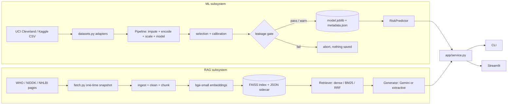
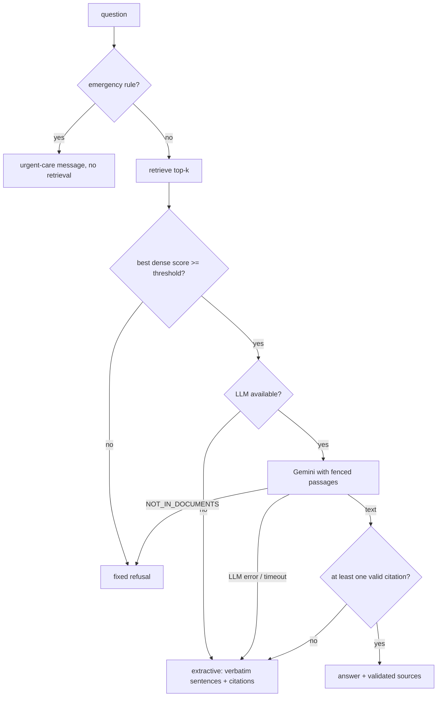
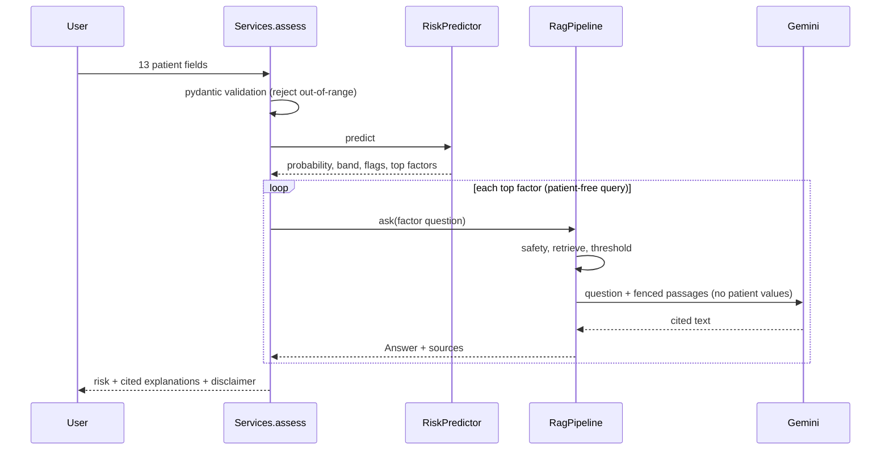

# Architecture

`hcai` is two independent subsystems (a tabular risk model and a grounded document QA system) joined by a thin application layer. Either can be down without taking the other with it. This file explains how the pieces fit and why; `DESIGN.md` has the decision log, `BUILD_NOTES.md` the change history.

## 1. Scope
- **In scope:** train and evaluate a heart-disease presence classifier; answer questions from 9 public health documents with cited sources and an explicit "not in the documents" outcome; a CLI and a Streamlit app that combine both.
- **Out of scope (by design):** diagnosis or treatment advice, authentication, multi-user storage, a hosted vector database, agent frameworks. It is a demonstration prototype, not a medical device.

## 2. System overview

Two stores are written by `train` and `index` and only read at serving time: `artifacts/model.joblib` (+ metadata) and `artifacts/index/`. Nothing is scraped or trained at query time.

## 3. ML subsystem (`src/hcai/ml/`)
| Module | Responsibility |
|---|---|
| `data.py` | Download/cache UCI Cleveland, validate schema, binarise `num > 0`, data hash |
| `datasets.py` | Registry + adapters. Kaggle Heart Failure is mapped onto the same 13 columns; `ca`/`thal` stay all-NaN. `config_for()` gives non-default datasets their own artifact folder |
| `schema.py` | Feature lists, labels, `PatientInput` (pydantic, clinical range checks; reject, never clamp) |
| `features.py` | `FeatureSpec` (which columns exist / get missing flags) and one sklearn `Pipeline` per candidate, so every fitted step sees training data only |
| `train.py` | Stratified split → grid search in repeated CV per candidate → select → optional calibration → one test evaluation → leakage gate → save → archive |
| `evaluate.py` | Metrics, bootstrap CIs, paired bootstrap AUC differences, selection rule, plots |
| `leakage.py` | Duplicate rows, single-feature proxy, label-shuffle AUC; `judge()` turns them into pass / warn / fail; `split_stability()` |
| `registry.py` | joblib artifact with sklearn version, feature schema and sha256, verified on load |
| `predict.py` | `RiskPredictor`: probability, band, range flags, ignored/imputed fields, top risk-increasing factors by one-at-a-time occlusion |
| `runs.py` | Immutable run summaries, import of an earlier `metrics.json`, `compare` |

**Selection rule.** Highest cross-validated ROC-AUC on the training split, but the logistic-regression baseline is kept unless a rival beats it by more than `ml.selection_margin` (0.01). With 242 training rows the CV standard deviation (~0.04) is larger than that margin, so the rule is deliberately conservative. The test set is touched once, after selection.

**Leakage gate.** Three direct checks (train/test duplicates; any single feature with AUC ≥ 0.98; a baseline trained on shuffled labels must score ≤ 0.65 on the test set). A failed check aborts and saves nothing but keeps the evidence and archives the run. A high AUC with clean checks only warns, because a 61-row test set moves several AUC points between splits (`hcai stability` measures this).

**Missing data.** Median/mode imputation inside the pipeline, plus was-missing flags for columns with NaN. Columns a dataset lacks entirely (`ca`, `thal` in Kaggle) are dropped inside the pipeline, so the predictor still takes the same 13-field input and reports which fields it ignored.

## 4. RAG subsystem (`src/hcai/rag/`)
| Stage | Module | Notes |
|---|---|---|
| Snapshot | `fetch.py` | One-time download; browser-like headers; documented alternates if a primary URL fails; manifest records the URL actually used, licence, date, sha256 |
| Clean | `ingest.py`, `textio.py` | Encoding-robust decode, HTML/boilerplate removal, unicode normalisation |
| Chunk | `chunking.py` | Heading-aware, ~300 words, 45-word overlap, hard max 380; chunks carry title + section |
| Embed | `embeddings.py` | `BAAI/bge-small-en-v1.5` (384-d, CPU, normalised); query instruction prefix; hashing embedder for offline tests |
| Store | `store.py` | FAISS `IndexFlatIP` + JSON sidecar behind a `VectorStore` protocol; refuses a missing, corrupt or size-mismatched index |
| Retrieve | `retriever.py`, `bm25.py`, `rerank.py` | Dense (default), BM25 or hybrid (reciprocal-rank fusion); per-document diversity cap; optional cross-encoder rerank. The answerability threshold always uses the dense cosine score |
| Gate | `safety.py` | Emergency red-flag rules run before retrieval or any LLM call |
| Generate | `generator.py`, `prompts.py` | Gemini (free tier) with one shared deadline and model fallback; extractive no-LLM fallback; fenced passages; `[C#]` citations parsed (including grouped tags) and validated against the retrieved set |
| Orchestrate | `pipeline.py` | `ask()`: safety → retrieve → threshold → generate → validate → `Answer` with sources |

### Answer decision flow

Two independent "not in the documents" layers exist: the retrieval-score threshold (cheap, calibrated on the golden set) and the LLM's own `NOT_IN_DOCUMENTS` reply. The evaluation shows the second layer does real work (see README, RAG analysis).

## 5. Application layer (`src/hcai/app/`, `report.py`)
- `service.py` builds both subsystems lazily and independently. `assess()`: validate input → predict → for each top risk-increasing factor, ask the RAG pipeline a fixed, patient-free question → attach answers and notes. If the index is missing the risk estimate is still returned; if the model is missing `ask` still works.
- `cli.py` is the only place that prints. Commands: `data train stability runs compare index ask assess eval report monitor status`.
- `streamlit_app.py` renders the same `Services` calls.
- `report.py` writes measured numbers into the README block and copies the full reports to `docs/results/`; nothing is typed by hand.

## 6. Contracts between stages
| Artifact | Producer → consumer | Integrity |
|---|---|---|
| `artifacts/model.joblib` + `model_metadata.json` | `train` → `RiskPredictor` | sklearn version, feature list, sha256 checked on load; metadata has data hash, git sha, ranges, reference values, absent features |
| `artifacts/index/` (FAISS + JSON) | `index` → `Retriever` | sha256 of index + chunks, vector count and dimension checked on load; the embedding-model name is stored and reused to embed queries |
| `data/raw/docs/` + `manifest.json` | `fetch_docs` → `index` | sha256 per document verified at ingest; a missing or edited file stops the build; empty or duplicate documents are skipped and logged |
| `artifacts/runs/<id>/summary.json` | `train` → `compare`, `report` | immutable; carries data hash, seed, build, verdict |
| `artifacts/reports/*` | `train/eval/stability/compare` → `report` | README numbers come only from here |
| `artifacts/metrics.jsonl` | app → `monitor` | whitelisted fields only (no patient values, no question text) |

## 7. Trust boundaries, safety and privacy
- **Documents are data, not instructions.** Passages are fenced in the prompt and the system prompt says to ignore instructions inside them; tests include a poisoned document.
- **Citations are checked, not trusted.** Tags not in the retrieved set are stripped and logged; uncited LLM prose is never shown.
- **Patient values never leave the machine.** Only the question and retrieved passages go to Gemini; factor questions are fixed strings.
- **Logs.** Request id, latency, scores, token counts, refusal/fallback flags, range flags. No patient input, no question text.
- **Emergency rules** fail towards alerting; general questions ("can high blood pressure lead to a stroke?") pass through.
- **Secrets** only from environment / `.env` (gitignored). `joblib` files are pickles: load only models you trained.

## 8. Failure modes and degradation
| Failure | Behaviour |
|---|---|
| No Gemini key, quota exhausted, timeout | Extractive answer (verbatim cited sentences). One 25 s deadline covers all models and retries |
| Model artifact missing / incompatible | `assess` stops with a retrain message; `ask` unaffected |
| Index missing / corrupt | `ask` stops with a re-index message; risk estimate still returned |
| Out-of-range patient field | Rejected with the field named; nothing clamped |
| Value outside training range | Estimate returned with an extrapolation note |
| Leakage check fails in training | Abort, nothing saved, evidence and archived run kept |
| Document download blocked (403) | Alternate source used and recorded; manual `--add-local` as last resort |

## 9. Configuration and reproducibility
One file, `configs/default.yaml`, validated by pydantic (`extra=forbid`): seed, split, CV, grids, selection margin, leakage limits, chunking, retrieval mode, thresholds, LLM models/timeouts. Seed 42; `requirements.lock` pins the versions the tests passed with; the model artifact records the data hash and sklearn version.

## 10. How it is tested
`tests/` (hermetic, no network): fakes for the embedder (hashing), the LLM (scripted) and the Gemini SDK (scripted clock and errors); synthetic patient data used only for tests, never for reported metrics. Coverage focuses on boundaries (validation, artifact checks, index corruption), the leakage gate (clean, warn, abort), citation handling, safety rules, degradation paths, CLI error messages and a Streamlit smoke test.

## 11. Extension points
New LLM: implement `LLMClient.complete`. New vector store: implement `VectorStore`. New dataset: add an adapter returning the 13-column frame in `datasets.py`. New candidate model: add to `features.build_pipeline` and `ml.candidates`/`ml.grids`.
